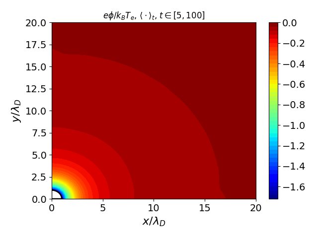
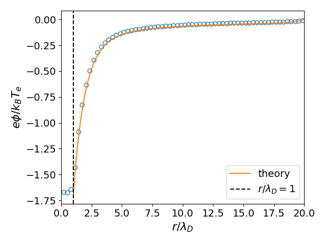

# 2D Orbital-MotionLimited (OML) Sheath (Full Two-Species)

A **full two-species** (electron + ion) Vlasov-Poisson simulation of a plasma sheath forming around a circular dielectric dust.

## Physics

- **Domain**: quarter domain $[0, 20]\lambda_D \times [0, 20]\lambda_D$ in $(x, y)$ with the dust at the origin; by mirror symmetry this represents the full $[-20, 20]^2\lambda_D$ box at a quarter of the cost.
- **Normalization**: $T_i/T_e = 1$, $m_i/m_e = 100$
- **Boundary conditions**: symmetry planes at $x = 0$ and $y = 0$ (specular reflection for $f$, even reflection for $\phi$); Maxwellian injection and Dirichlet potential (fixed to 0) at the right and top walls.
- **Initial distribution**: Boltzmann-depleted Maxwellian for electrons. Ions, with `[init] trapped_ion_free = true` (default), start as a Maxwellian in total energy restricted to $E = m_i v^2/2 + e\phi \ge 0$, so no ion is initially bound; set it to `false` for an unperturbed Maxwellian.
- **Diagnostic** `ni_bound`: density of bound ions ($E < 0$). These cannot exist in OML theory; a nonzero value measures the trapped population generated by the scheme.
- **Charging dust**: Dust is dielectric with $\epsilon=5$ and surface charge accumulates as it absorbs plasma.

## Build

```bash
cmake -B build && cmake --build build --target sheath_oml
```

## Run

```bash
build/sheath_oml examples/sheath_oml/input.ini
```

## Analysis

```bash
python examples/sheath_oml/plottings.py
python examples/sheath_oml/make_anime.py
```

## Results




